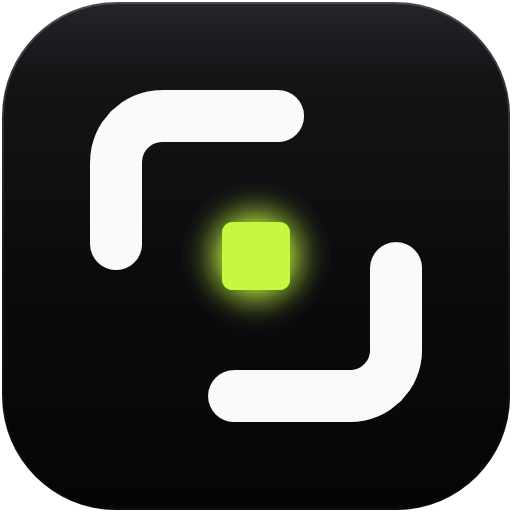

<p align="center">
  
</p>

<h1 align="center">Snappy</h1>

<p align="center">
  A Windows snipping tool that captures <strong>true native pixels</strong>: every screenshot is the display's real
  physical resolution, never downscaled by Windows display scaling, even on mixed-DPI multi-monitor setups.
</p>

## Download

Get **`Snappy.exe`** from the [latest release](https://github.com/MiladRTX/Snappy/releases/latest) and run it.
It's one file with everything included, so there's nothing to install (no .NET needed), for 64-bit
Windows 10 and 11. Snappy isn't code-signed yet, so Windows SmartScreen may warn the first time:
choose **More info**, then **Run anyway**.

To run from source instead (needs the .NET 10 SDK):

```bash
dotnet run --project src/Snappy
```

## Use

Snappy lives in the notification area. Start a capture by:

- pressing a shortcut (region capture is `Insert` by default; see Settings),
- left-clicking the tray icon, or using its right-click menu, or
- running `Snappy.exe --capture` (handy for other launchers and macro keys).

Launching Snappy again (from Start or a pinned taskbar icon) opens the Settings window.

## Capturing

The screen freezes and dims; the toolbar at the top switches modes.

| Key | Action |
| --- | --- |
| `R` | Region: drag a rectangle (the magnifier shows exact pixels and colors) |
| `W` | Window: click a window (captures its visible frame, without invisible borders; a window partly behind others is captured by itself, without what covers it) |
| `F` | Screen: click a display |
| `Enter` | In Screen mode: all displays; in Window mode: the hovered window |
| `Esc` / right-click | Cancel |

Each capture is copied to the clipboard (PNG and bitmap) and saved as a lossless PNG in
`Pictures\Snappy`. A notification shows the size and lets you open the file or its folder.

## Settings

Open **Settings** from the tray menu (or launch Snappy again). Changes are saved and applied as
you make them:

- **General**: start with Windows (quietly, in the tray; the switch shows whether this copy of
  Snappy really starts, including when Windows' Startup apps list has turned it off), the capture
  notification, and light/dark/system appearance.
- **Capture**: copy to clipboard, save to a file, the save folder and the file name pattern
  (with a live preview).
- **Shortcuts**: record a global shortcut for each of region, window, display and all displays.
  Snappy tells you right there if another app already owns a shortcut or two actions share one.

Everything is stored in `%AppData%\Snappy\settings.json`, which you can also edit by hand; Snappy
picks up changes as soon as the file is saved.

| Setting | Default | |
| --- | --- | --- |
| `hotkey` | `Insert` | region capture; e.g. `Ctrl+Alt+S`, `Ctrl+PrintScreen`, `F9`, `Win+F9`; `""` turns it off |
| `windowHotkey` | `""` (off) | window capture |
| `screenHotkey` | `""` (off) | display capture |
| `allDisplaysHotkey` | `""` (off) | all displays at once, no overlay |
| `saveFolder` | `Pictures\Snappy` | environment variables like `%USERPROFILE%` work |
| `fileNamePattern` | `Snappy_{yyyy-MM-dd_HH-mm-ss}` | `{...}` holds a .NET date/time format |
| `saveToFile` | `true` | |
| `copyToClipboard` | `true` | |
| `showNotification` | `true` | errors are always shown |
| `theme` | `System` | `System`, `Light` or `Dark` |

A single key works as a shortcut (`Insert`, `F9`, `PrintScreen`, `Pause`...) as long as it isn't one
you type or move through text with: letters, digits, punctuation, `Space`, `Enter`, `Tab`, the
arrows, `Home`/`End`/`Page Up`/`Page Down` and the like need a modifier (`Ctrl`, `Alt`, `Shift`
or `Win`), so they can't hijack normal typing. A single-key shortcut stops that key working in
other apps while Snappy runs.

## How captures stay native

- `app.manifest` declares **Per-Monitor V2** DPI awareness, so every Win32 coordinate Snappy sees
  (display bounds, window bounds, cursor, the `BitBlt` source) is in physical pixels.
- The whole virtual desktop is copied once with GDI `BitBlt` into a 32-bit DIB; selections are
  cropped from that frozen image.
- Each display gets its own overlay window pinned to its exact physical rectangle, showing its
  slice of the frozen image at 1:1, so a 125% and a 100% display both render crisply.

Known limits: UAC prompts, DRM video and windows that opt out of capture come out black; HDR
displays are captured as SDR.

## Tests

```bash
dotnet test
```

Includes a real capture of the machine's displays, checked against each display's video mode.

## Credits

Icons are from [Phosphor Icons](https://phosphoricons.com) 2.1.1 (bold weight), © 2023 Phosphor
Icons, under the MIT License (see [THIRD-PARTY-NOTICES.md](THIRD-PARTY-NOTICES.md)). Their path
data is used unchanged in `src/Snappy/Themes/Icons.xaml`.
